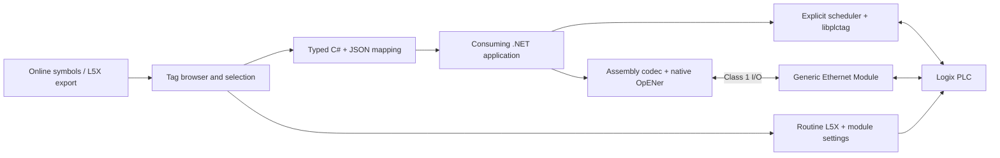

# Architecture

The same generated typed model and configuration feed either explicit symbolic I/O
or implicit assembly I/O. The browser is a design tool; it is not required at runtime.

## Ownership and synchronization

Every selected leaf has one direction, from the consuming application's perspective.
PLC-to-app leaves are read-only to the consumer; app-to-PLC leaves are writable by
the consumer. A mixed UDT can be selected member by member. This avoids read/modify/write
races where a PLC scan and an application update own different bits of the same buffer.
There is no last-writer-wins mode for the same field in this preview.

`PlcVariable<T>` locks value/version/quality changes. A captured version is acknowledged
only after the explicit driver succeeds or the PLC echoes an implicit image sequence.
A newer local edit is not cleared by an older acknowledgement. Quality is initially
Unknown, becomes Good after a successful transfer, and becomes Bad on a failed/stale group.
Timestamps are PC UTC observations, not PLC timestamps. Reading several variables
separately does not constitute an atomic class snapshot.

Explicit reads are staged before publishing; writes are individually sent only when
dirty. This is not an atomic CIP multi-tag transaction. Whole UDT transfers and request
packing can be added behind the transport once native template offsets, access and
preservation have been established; they are not inferred from L5X member order.

## Implicit payload contract v1

All values use little-endian encoding. Offsets are generated separately for each direction.
The contract is independent of CLR and PLC UDT memory layout. Fields start on 4-byte
boundaries; unused padding is zero. BOOL uses a DINT wire value (0/1); SINT is signed
8-bit, INT is signed 16-bit, DINT signed 32-bit, LINT signed 64-bit and REAL IEEE binary32.

| Byte offset | Type | Meaning |
| --- | --- | --- |
| 0 | DINT | Magic `0x50535031` |
| 4 | DINT | Protocol version 1 |
| 8 | DINT | First 32 bits of SHA-256 mapping hash, interpreted little-endian |
| 12 | DINT | Nonnegative 31-bit sender sequence |
| 16 | DINT | Last accepted peer sequence |
| 20 | DINT | Valid = 1 |
| 24 onward | mapped fields | Selected leaves and zero padding |

The full SHA-256 hash is stored in JSON; the wire token is a 32-bit mismatch detector,
not authentication or a collision-proof identity. C# output sequences start at a
randomized nonzero value to reduce restart collisions. There is no durable epoch or
exactly-once replay protocol yet. The codec uses a 31-bit modular freshness comparison;
the host must restart after a PLC reset/disconnection rather than treating a new PLC
sequence epoch as the old one. Network integrity/security is a deployment concern;
this preview does not implement CIP Security or CIP Safety.

Input/output naming follows the PLC. The PLC output assembly contains status for the
PC; the PLC input assembly contains app-owned commands for the PLC. OpENer consumes
the former and produces the latter. CIP connection sequence and Run/Idle headers are
handled by OpENer and excluded from configured SINT payload lengths.

The PLC routine CPS-copies the input assembly into a local SINT buffer, validates its
header and permission, converts BOOLs through DINT storage, copies numeric leaves
individually, and echoes acceptance after those copies. Numeric receive CPS has
length 1 because its destination is a single native scalar. Transmit CPS length is
the number of bytes because its destination is SINT. The routine then builds its
outgoing image, including status leaves and the acknowledgement, and CPS-copies it
into the module output. This supports arbitrary selected UDT members without copying
unknown padding or packed BOOL storage back over unrelated fields.

Field-wise CPS does not freeze all source tags across a PLC scan or other tasks.
Applications needing a consistent process snapshot should create a dedicated PLC
snapshot UDT and update it in the appropriate task. Command acceptance means copying
to the selected destination succeeded in the generated routine, not that application
logic executed or a physical action completed.

## Native boundary

OpENer is a source-pinned submodule. CMake replaces its SAMPLE_APP build target's
callback source with the relay application; the dependency checkout remains unchanged.
The bridge exports a small C ABI for start, stop and complete-image exchange. OpENer's
network worker owns stack callbacks. An SRW lock protects managed/native image exchange,
and consumers receive copied buffers. Stack globals allow one adapter lifecycle per
process. Shutdown retains its exact worker handle on timeout; it never terminates
another process, force-terminates the worker or unloads a live native stack.

The library has no PLC project service dependency. It does not open Studio 5000,
download logic, edit an online project or automatically import generated L5X.

## Reference review

The old PiperXMLRelay code supplied the useful concepts of trigger-driven transactions,
completion status and per-tag mapping. Its WinForms component lifecycle, XML conversion
layer and AdvancedHMI implementation were not carried into the reusable runtime.
The PLCCodeGenerator archive supplied examples of generation stages and L5X context
structure. No third-party archive source was copied. The communications notes correctly
identify the importance of adapter versus scanner roles.

Primary references checked during implementation:

- [libplctag.NET](https://github.com/libplctag/libplctag.NET): explicit typed reads/writes, async lifecycle and tag/template listing.
- [libplctag symbol/UDT example](https://github.com/libplctag/libplctag.NET/blob/main/examples/CSharp%20DotNetCore/ExampleListPlc.cs): catalog record concepts.
- [EEIP.NET](https://github.com/rossmann-engineering/EEIP.NET): scanner and explicit-client scope; not the adapter selected here.
- [OpENer](https://github.com/EIPStackGroup/OpENer): adapter stack, Windows integration API and application callbacks.
- [Rockwell CPS reference](https://www.rockwellautomation.com/en-gb/docs/studio-5000-logix-designer/38-03/contents-ditamap/instruction-set/array-file-misc-instructions/copy-synchronous-copy-file--cps-.html): destination-element lengths and synchronous copies.
- [Microsoft .NET lifecycle](https://learn.microsoft.com/en-us/lifecycle/products/microsoft-net-and-net-core): choose a supported host runtime for deployment.
