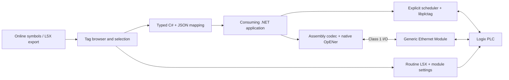

# Architecture

The same generated typed model and configuration feed either explicit symbolic I/O
or implicit assembly I/O. The browser is a design tool; it is not required at runtime.

## Access and synchronization

Each leaf is PLC-to-app, app-to-PLC or bidirectional. Bidirectional values follow PLC
reads when clean and retain local edits until completion. Whole-UDT bidirectional
selection keeps externally read-only members read-only. Explicit mode reads UDT root
snapshots and writes changed member paths, preserving unrelated members. Implicit
mode uses the PLC-first SINT merge against the exact frozen snapshot; the AOI itself
has no field, type or permission information.

`PlcVariable<T>` locks value/version/quality changes. A captured version is acknowledged
only after the explicit driver succeeds or the PLC echoes an implicit image sequence.
A newer local edit is not cleared by an older acknowledgement. Quality is initially
Unknown, becomes Good after a successful transfer, and becomes Bad on a failed/stale group.
Timestamps are PC UTC observations, not PLC timestamps. Reading several variables
separately does not constitute an atomic class snapshot.

Explicit reads are staged and validated before publishing. Generated read groups let
LogixTransport read each selected UDT root using native template metadata, then decode
members at reported offsets. Writes are individually addressed and sent only when
dirty and different from the fresh read. No UDT buffer is written back. Native offsets
are not inferred from L5X member order. This is not an atomic CIP multi-tag transaction;
see [synchronization](SYNCHRONIZATION.md) for conflict semantics and metadata lifetime.

## Implicit payload contract v3

All values use little-endian encoding. Both directions use one shared layout and equal sizes.
The contract is independent of CLR and PLC UDT memory layout. Fields start on 4-byte
boundaries. A fresh image has zero padding; echoed/native string padding is preserved. BOOL uses a DINT wire value (0/1); SINT is signed
8-bit, INT is signed 16-bit, DINT signed 32-bit, LINT signed 64-bit and REAL IEEE binary32.

| Byte offset | Type | Meaning |
| --- | --- | --- |
| 0 | DINT | Magic `0x50535031` |
| 4 | DINT | Protocol version 3 |
| 8 | DINT | First 32 bits of SHA-256 mapping hash, interpreted little-endian |
| 12 | DINT | Positive 31-bit sender sequence, wraps from max to 1 |
| 16 | DINT | API: referenced PLC baseline; PLC: accepted API command sequence |
| 20 | DINT | Valid = 1 |
| 24 onward | mapped fields | Every selected leaf at the same offset in both directions |

STRING occupies a DINT LEN followed by exactly its declared SINT DATA[N] capacity,
then tail alignment to four bytes. The schema hash includes the string capacity.
Text maps byte values 0..255 losslessly to U+0000..U+00FF. LEN, rather than a null byte,
controls decoding. Over-capacity text, invalid LEN, truncated data and unrepresentable
characters are rejected. All fields are decoded before any image observations are published.
Explicit transfers use one native whole-string buffer, validate its expected size,
and preserve native tail padding during a write.

Array coordinates use Logix comma syntax and rightmost-index-fastest order. Generated
models use C# rectangular arrays. Tag arrays may have one, two or three dimensions;
UDT member arrays may have one dimension, following the native Logix restriction.

The full SHA-256 hash is stored in JSON; the wire token is a 32-bit mismatch detector,
not authentication or a collision-proof identity. C# output sequences start at a
randomized nonzero value to reduce restart collisions. There is no durable epoch or
exactly-once replay protocol yet. The codec uses a 31-bit modular freshness comparison;
the host must restart after a PLC reset/disconnection rather than treating a new PLC
sequence epoch as the old one. Network integrity/security is a deployment concern;
this preview does not implement CIP Security or CIP Safety.

Input/output naming follows the PLC. Both assemblies contain the entire contract.
The PLC output assembly contains actual values, including command readback. The PC
echoes that image, overlays captured dirty app-owned values and updates its header. OpENer consumes
the former and produces the latter. CIP connection sequence and Run/Idle headers are
handled by OpENer and excluded from configured SINT payload lengths.

The PLC routine freezes each published output frame until a fresh API command
references its exact sequence. Startup API frames are invalid and cannot write data.
The API builds its first request only after receiving a valid baseline; it allows one
outstanding command. Retransmissions preserve both payload and baseline reference.

The wrapper packs current PLC leaves into a payload SINT array, stages the received
payload and protects PLC-only slots by replacing those slots with current bytes.
It calls the embedded Structured Text AOI with exactly three equal-length arrays:
LastSent, Current and Received. Each byte follows `Current == LastSent ? Received : Current`.
All type knowledge stays outside the AOI. Byte merging can produce a multi-byte value
neither writer supplied. STRING LEN is checked both before and after merging; invalid
length prevents every destination copy and acknowledgement, and the exchange times out.

Only writable leaves are copied back. BOOLs use a DINT temporary; native scalar/string
destinations use CPS length 1, while SINT destinations count bytes. UDTs and arrays are
expanded into leaf copies without inferring native UDT padding or BOOL storage.
After applying a merge, the wrapper builds a new frame with all actual tag readbacks
and command acknowledgement, writes module output, and immediately saves its payload
as LastSent. Sequence advances only at publication, so LastSent always belongs to the
baseline referenced by the next accepted command. No API traffic means the published
snapshot remains frozen, although local PLC tags can keep changing.

Acknowledgement means the merge completed, including PLC-winning bytes. The API
adopts the actual merged value only if its local version still matches the sent version;
newer app edits remain dirty. Clean fields echo PLC bytes rather than reasserting a
rejected desired value. A 1000 ms watchdog diagnoses missing fresh exchanges; application
logic decides how to respond. Reset invalidates staging state and requires API restart.

Field-wise CPS does not freeze all source tags across a PLC scan or other tasks.
Applications needing a consistent process snapshot should create a dedicated PLC
snapshot UDT and update it in the appropriate task. Command acceptance means copying
to the selected destination succeeded in the generated routine, not that application
logic executed or a physical action completed.

## Native boundary

OpENer is a source-pinned submodule. CMake replaces its SAMPLE_APP build target's
callback source with the relay application; the dependency checkout remains unchanged.
The bridge exports a small C ABI for start, stop and complete-image exchange. OpENer's
network worker owns stack callbacks. An SRW lock protects managed/native image exchange,
and consumers receive copied buffers. Stack globals allow one adapter lifecycle per
process. Shutdown retains its exact worker handle on timeout; it never terminates
another process, force-terminates the worker or unloads a live native stack.

The library has no PLC project service dependency. It does not open Studio 5000,
download logic, edit an online project or automatically import generated L5X.

Module generation uses a native exported template and retains its raw source SHA-256.
It rejects separate status connections, nonzero configuration payloads, mismatched
instances and unequal image sizes. It changes only known name/address/RPI/size/data
fields. Opaque CommMethod, configuration prefix and parent routing remain source-bound.
The native export stays outside public source control. Synthetic template tests establish
XML/mapping behavior, not Studio 5000 import acceptance.

## Reference review

The old PiperXMLRelay code supplied the useful concepts of trigger-driven transactions,
completion status and per-tag mapping. Its WinForms component lifecycle, XML conversion
layer and AdvancedHMI implementation were not carried into the reusable runtime.
The PLCCodeGenerator archive supplied examples of generation stages and L5X context
structure. No third-party archive source was copied. The communications notes correctly
identify the importance of adapter versus scanner roles.

Primary references checked during implementation:

- [libplctag.NET](https://github.com/libplctag/libplctag.NET): explicit typed reads/writes, async lifecycle and tag/template listing.
- [libplctag symbol/UDT example](https://github.com/libplctag/libplctag.NET/blob/main/examples/CSharp%20DotNetCore/ExampleListPlc.cs): catalog record concepts.
- [EEIP.NET](https://github.com/rossmann-engineering/EEIP.NET): scanner and explicit-client scope; not the adapter selected here.
- [OpENer](https://github.com/EIPStackGroup/OpENer): adapter stack, Windows integration API and application callbacks.
- [Rockwell CPS reference](https://www.rockwellautomation.com/en-gb/docs/studio-5000-logix-designer/38-03/contents-ditamap/instruction-set/array-file-misc-instructions/copy-synchronous-copy-file--cps-.html): destination-element lengths and synchronous copies.
- [Microsoft .NET lifecycle](https://learn.microsoft.com/en-us/lifecycle/products/microsoft-net-and-net-core): choose a supported host runtime for deployment.
- [Rockwell data type editor](https://www.rockwellautomation.com/en-ro/docs/studio-5000-logix-designer/37-02/contents-ditamap/studio-5000-logix-designer/data-type-editor/data-type-editor-settings.html): UDT member array limits and custom string capacities.
- [libplctag string layout](https://github.com/libplctag/libplctag/wiki/Strings-and-String-Handling): counted strings and native alignment.
